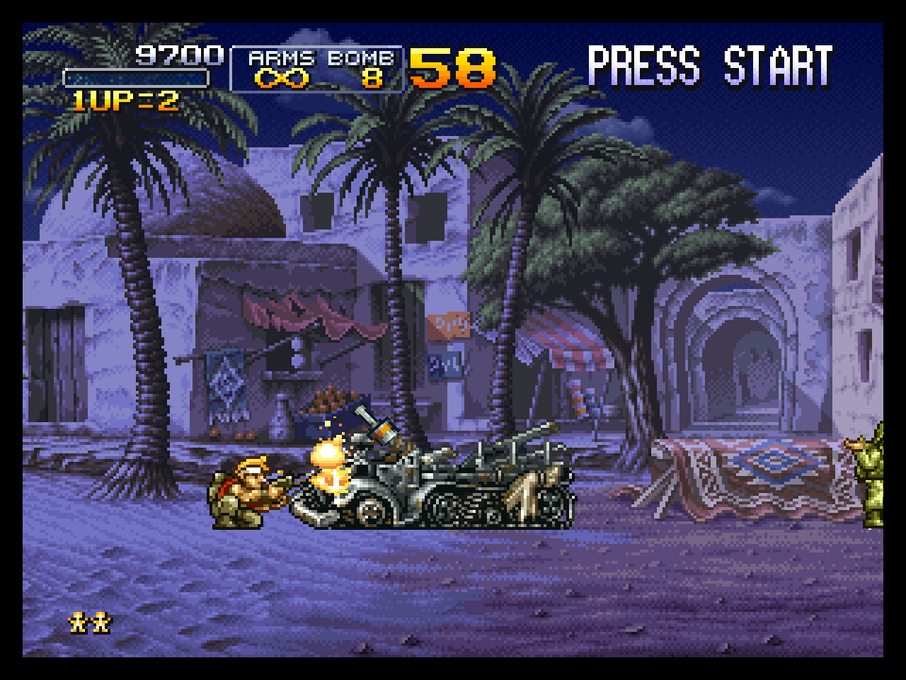
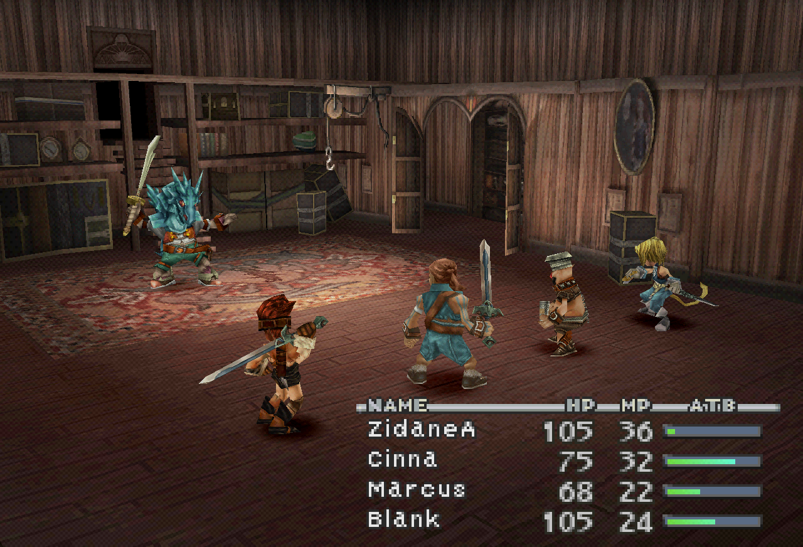
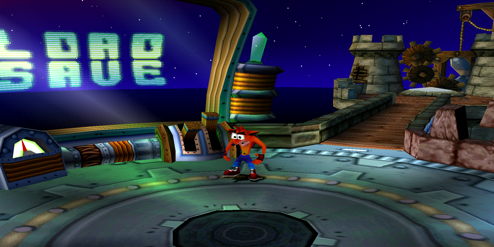

# muyiunative

Play your own PlayStation (PS1) discs natively on the Mac, and later on the iPhone. Bring your game (a `.cue`/`.bin` dump of your disc); muyiunative turns it into an app.

The aim is native code, not emulation: the game's MIPS code is translated to C and compiled ahead of time on your Mac, and runs as Apple-silicon code beside a runtime that models the console's hardware; an interpreter covers the code that could not be compiled ahead of time. No game files or Sony BIOS dumps are included: the BIOS muyiunative runs is [OpenBIOS](bios/openbios/README.md), open source and built from source. The gallery shows selected screenshots of games running in muyiunative. The project is not affiliated with Sony Interactive Entertainment or any game publisher.

## Status

The [0.7.0 Mac preview is available](https://github.com/lukegskw/muyiunative/releases/tag/v0.7.0). The launcher builds game apps, with two controller ports, logs and problem reports, persistent memory cards and keyboard remapping. The downloaded-launcher build/controller flow has passed its [player check](docs/development.md#phase-7-the-public-preview). Software is the default renderer; Metal offers 1×, 2× and 4× geometry. Only the games and routes in the [compatibility list](#compatibility) have been verified. Whole-game compatibility, whole-route live audio accuracy and hardware timing remain open; expect bugs.

## Install

You need **Apple silicon and macOS 14 or later**. Intel Macs, iPhone and older macOS versions are not supported yet. Building a game app needs Apple's free Command Line Tools; playing a completed app needs no developer tools. Bring a `.cue`/`.bin` dump of your own PS1 disc. A CUE and all the track files it references must stay together; compressed formats such as CHD are not accepted.

Download [muyiunative-0.7.0-mac-arm64.zip](https://github.com/lukegskw/muyiunative/releases/download/v0.7.0/muyiunative-0.7.0-mac-arm64.zip) from the [0.7.0 release](https://github.com/lukegskw/muyiunative/releases/tag/v0.7.0), double-click the ZIP in Finder, and move `muyiunative.app` to your Applications folder. The launcher is Developer ID-signed and notarized by Apple, with its notarization ticket attached; players need no Apple Developer account. Open it and accept macOS's normal first-launch confirmation. If macOS reports an invalid signature, damaged app or failed verification, report that failure before proceeding.

Choose **Build Game App…** to use your own disc. Keep generated game apps on your Mac: they contain a copy of your disc and cannot be redistributed. The release also provides a SHA-256 checksum; building from source remains available [below](#build-from-the-command-line).

## Compatibility

Games tested on the Mac. Open a game's image or title for its tested revision, progress and known issues; the [game notes](profiles/README.md) collect the compatibility details. The gallery follows [nxnative's presentation](https://github.com/seedds/nxnative#games).

The FF IX and Crash captures use local source changes newer than the published 0.7.0 preview. Their profiles record the fixes and tested scope; those fixes are not yet in that download.

<table>
<tr>
<td align="center" valign="top" width="33%">
<a href="profiles/SLUS-01212/README.md"></a><br>
<b><a href="profiles/SLUS-01212/README.md">Metal Slug X</a></b><br>
<sub>SLUS-01212 · Mac<br>Mission 1 verified · Xbox Bluetooth</sub>
</td>
<td align="center" valign="top" width="33%">
<a href="profiles/SLUS-01251/README.md"></a><br>
<b><a href="profiles/SLUS-01251/README.md">Final Fantasy IX</a></b><br>
<sub>SLUS-01251 · Mac<br>First battle · Metal 4× source build</sub>
</td>
<td align="center" valign="top" width="33%">
<a href="profiles/SCES-01420/README.md"></a><br>
<b><a href="profiles/SCES-01420/README.md">Crash Bandicoot 3 - Warped</a></b><br>
<sub>SCES-01420 · Mac<br>Time Twister hub · Metal 4× source build</sub>
</td>
</tr>
</table>

These checks do not establish full-game compatibility. The Metal Slug X first-mission route uses five continues. The new profiles document the graphics corrections, audio measurements and remaining validation limits. Unseen code falls back to the interpreter, which does not guarantee compatibility with an unknown game. Screenshots show actual muyiunative output; [capture details](docs/images/README.md) identify their build and renderer.

For a first test pass, follow the [game testing guide](docs/testing-games.md). To add evidence, open a [compatibility report](https://github.com/lukegskw/muyiunative/issues/new?template=compatibility_report.yml) with the title, serial, region, boot executable SHA-256, app version, renderer, controller and exactly how far you played. The form explains how to find the hash without a terminal. Report build failures too. Share hashes and observations, never disc data or game apps. For a vulnerability, use [private security reporting](SECURITY.md).

## Build from the launcher

Open muyiunative and choose **Build Game App…** (⌘N). Choose a `.cue` or `.bin` dump of your own disc, then choose where to save the app. The Save dialog starts in `~/Applications/muyiunative/`. Follow the current build step and live output in the build window; **Cancel Build** stops the build and removes its temporary files. On success, Finder reveals the app, and **Open Game App** starts it.

Player builds need only Apple's free Command Line Tools. If they are missing, the launcher offers **Install Tools**; finish Apple's installation, then choose Build Game App again. The launcher carries its sources, tools, profiles, OpenBIOS and precompiled Metal library. It uses the CLT's Python 3.9 or newer, with the MIT-licensed Tomli backport included; no separate Python, full Xcode or Metal compiler is needed for player builds. Temporary files go in `~/Library/Caches/muyiunative/Builds/` and are removed after success, failure or cancellation. Finder runs keep the build output in the [run log](#version-and-problem-reports).

The [downloaded launcher](#install) carries everything except Apple's Command Line Tools. To build the launcher from source instead, use the commands below. Playing a completed game app needs no developer tools.

## Build from the command line

You need a Mac with Apple silicon, [Xcode](https://apps.apple.com/app/xcode/id497799835) 27.1 with its Metal Toolchain component, and Python 3.12 or newer. Install the component in Xcode Settings → Components, or run `xcodebuild -downloadComponent MetalToolchain` ([Apple's instructions](https://developer.apple.com/documentation/xcode/downloading-and-installing-additional-xcode-components)). In a clone of this repository:

```sh
scripts/muyiunative build /external/path/disc.cue --platform mac-app
```

The command captures the game's code, compiles it, checks the route against the interpreter and creates `shell/mac/build/apps/<game>.app`. Double-click that app to play on macOS 14 or later. Its signed bundle includes OpenBIOS, the native game code and a local copy of the disc's tracks; it works after moving the app or the original dump. Keep game apps and generated code on your Mac.

Add `--output /path/Game.app` to choose another location. A known profile supplies the title and capture route: `first_level` when available, otherwise `validation`. Use `--route <table>`, `--frames <n>` and repeatable `--input <frame>:<hex-buttons>` to choose a route. Unknown games default to a 2,400-frame capture; code not seen during capture runs in the interpreter. Supported disc layouts are in [Development](docs/development.md#phase-2-hardware-breadth).

For the shorter command in the plan, add this checkout's scripts to your terminal's path:

```sh
export PATH="$PWD/scripts:$PATH"
muyiunative build /external/path/disc.cue --platform mac-app
```

Build the launcher, including its signed source kit, and open it:

```sh
make -C shell/mac app
open shell/mac/build/muyiunative.app
```

### Memory cards

Game apps connect two memory cards and save them in `~/Library/Application Support/muyiunative/Saves/<serial>-<boot-sha256>/card1.mcr` and `card2.mcr`. They are raw 128 KB images, created only when missing, saved once per emulated second when dirty and again before quitting. Moving or rebuilding the same game app preserves its saves. Close the game before backing up or replacing its cards; a second copy cannot use the same save folder simultaneously. Invalid cards are reported and kept intact.

### Quick states

In a built game app, choose **Game → Save State** (⌘S) to keep the current point, and **Game → Load State** (⌘L) to resume it, including after closing and reopening the app. There is one quick state per game; saving replaces it. The window title briefly confirms success. Load State becomes available once a state exists.

The file is `quick.ps1state` beside that game's memory cards in Application Support. Loading keeps the current memory-card contents and graphics choice. A busy card transaction, damaged file, different game/BIOS/disc or incompatible runtime format is reported without loading it. State compatibility across future runtime changes is not guaranteed; ordinary in-game saves remain separate. States stay outside the app and repository.

### Version and problem reports

Choose **About muyiunative…** in the app menu to see its version, build number and commit. The preview version is 0.7.0; the build number counts commits in the complete Git history. Every packed app carries this information, including game apps.

Apps opened from Finder save their output under `~/Library/Logs/muyiunative/<bundle id>/`, keeping the last five runs for that app. Each run is limited to 10 MiB; when full, the log preserves its version/commit header and recent output, with a marker where earlier output was omitted. Logs replace your home directory in paths with `~`. Errors and host/build information are enabled by default. **Include Game Debug Output** in the app menu enables the game's `tty:` text for the current session, including in the launcher's build window; it starts disabled on the next Finder launch.

**Report a Problem…** reveals the current log in Finder and opens the bug form with the version, commit, Mac model, macOS version, game serial and current renderer filled in. Describe the problem and review the log for personal information and game data before attaching and submitting it yourself. Other paths and enabled guest text can remain. Nothing is uploaded automatically. Never attach a disc, BIOS dump, memory card, save state, generated code or game app.

Terminal sessions keep their normal output; copy it for a report. Headless build and validation runs also keep stdout/stderr and create no persistent logs. An app started from a terminal with both streams redirected uses a log instead. A developer host using an external disc leaves the serial field empty; bundled game apps fill it from their metadata.

### Graphics

Choose Software or Metal at 1×, 2× or 4× in the game app's Graphics menu. Switching keeps the game running. Software remains the default. Metal draws the PS1 commands independently on the GPU; 2× and 4× add geometry samples, while textures retain their source resolution. Native-width lines, 24-bit video and texture-feedback regions retain native pixel detail. Interactive Metal presentation runs two frames behind CPU simulation to overlap rendering with the next frame's audio production; headless reference checks remain synchronous. The software GPU still maintains the console's reference VRAM, so this version prioritizes higher-resolution output and exact native rendering over a CPU speed-up.

To make an app open with Metal at 2×:

```sh
scripts/muyiunative build /external/path/disc.cue --platform mac-app --renderer metal --scale 2
```

The shader library is built and bundled with the app; playing needs no compiler. Headless runs default to software for reproducible validation. Developers can use `--renderer metal --scale 1 --verify-renderer` to compare native Metal VRAM and caches against software every frame ([Development](docs/development.md#phase-6-the-metal-renderer)).

### Controllers

Connect a macOS-supported extended gamepad over USB, or pair it in System Settings → Bluetooth. Game apps use Apple's GameController framework for wired and wireless input. The keyboard and first controller share port 1; a second controller uses port 2. Controllers can connect and disconnect during play. A remaining controller keeps its port; another controller fills the first vacant port. When the game window loses focus, both ports release their buttons until it regains focus.

| Controller control          | PlayStation button                 |
| --------------------------- | ---------------------------------- |
| South / East / West / North | Cross / Circle / Square / Triangle |
| Left / Right shoulder       | L1 / R1                            |
| Left / Right trigger        | L2 / R2                            |
| Menu / Options              | Start / Select                     |
| D-pad or left stick         | Up / Left / Down / Right           |

Face buttons follow their positions rather than their printed letters. The left stick becomes digital at ±0.5 on each axis; triggers activate at 0.5. D-pad and stick directions combine. A controller without an Options button can use the keyboard's Select binding on port 1. Xbox Bluetooth input has been checked in Metal Slug X; wired and two-player hardware checks are still pending ([Development](docs/development.md#phase-7-the-public-preview)).

### Keyboard controls

Use the left hand for movement and the right hand for the face buttons:

| Keyboard key  | PlayStation button       |
| ------------- | ------------------------ |
| W / A / S / D | Up / Left / Down / Right |
| I             | Triangle (△)             |
| J             | Square (□)               |
| K             | Cross (✕)                |
| L             | Circle (○)               |
| Q / E         | L1 / R1                  |
| 1 / 3         | L2 / R2                  |
| Enter/Return  | Start                    |
| Backspace     | Select                   |

On a Mac keyboard, Backspace is the key labelled Delete (⌫). With Metal Slug X's default controls, J fires, K jumps and L throws a grenade. Choose **Keyboard Controls…** in the game app's menu (⌘,) to change a binding: click its button, then press a key. Assigning an occupied key moves it to the new button; Unassign clears a binding, and Restore Defaults restores this table. Changes apply to all game apps.

### For developers

`make -C shell/mac` builds the developer host. Run `shell/mac/build/muyiunative --disc /external/path/disc.cue` to interpret an external disc, or add `--bios bios/openbios/openbios.bin` without a disc to open the BIOS shell. `--headless --lockstep` checks native execution against the interpreter. Headless runs leave card slots empty unless `--save-dir <directory>` is given, so existing validation routes remain reproducible.

`scripts/native_game.py /external/path/disc.cue --route first_level` reproduces phase 4's acceptance checks and timings. `scripts/survey_game.py /external/path/disc.cue --frames 2400` captures an unknown game and writes a draft profile and local picture to inspect. Captures, game apps and generated C stay in ignored build folders ([Development](docs/development.md#phase-5-the-mac-product)).

[Plan](plan.md) · [Development](docs/development.md) · [Contributing](CONTRIBUTING.md) · [Security](SECURITY.md) · [Notes for agents](AGENTS.md)

### Acknowledgements

muyiunative takes its build, its Mac front end and its rules for contributors and agents from **[nxnative](https://github.com/seedds/nxnative)** (MIT), which runs Switch games natively on Apple platforms. The console's hardware is modelled from **[psx-spx](https://psx-spx.consoledev.net/)**, the public PlayStation specifications. The BIOS is **OpenBIOS** from [nugget](https://github.com/pcsx-redux/nugget) (MIT), by the PCSX-Redux authors. The hardware test programs are **[ps1-tests](https://github.com/JaCzekanski/ps1-tests)** (MIT) by Jakub Czekański, built with [PSn00bSDK](https://github.com/Lameguy64/PSn00bSDK) (MPL-2.0). Player builds use [Tomli 2.2.1](tools/vendor/README.md) (MIT) for TOML parsing on Python 3.9.

### License

MIT ([LICENSE](LICENSE)). Third-party code keeps its own license, beside it: [OpenBIOS](bios/openbios/README.md) (MIT, with BSD parts), and the test programs of [ps1-tests](tests/ps1-tests/README.md) (MIT, with PSn00bSDK's libraries under MPL-2.0, which never reach the app).
