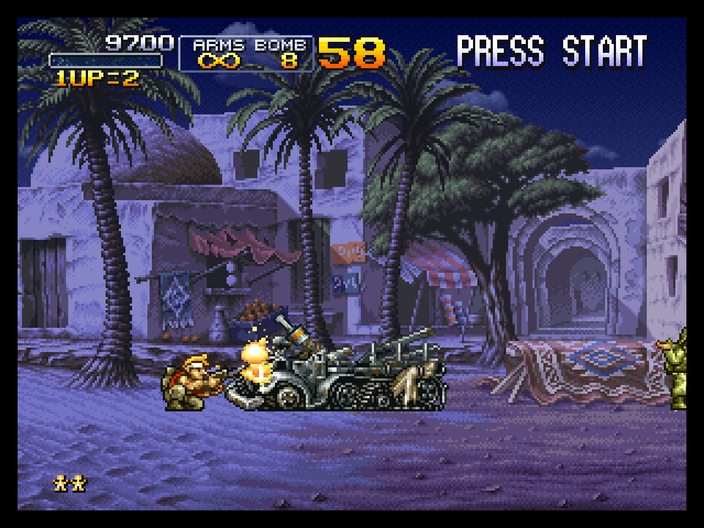
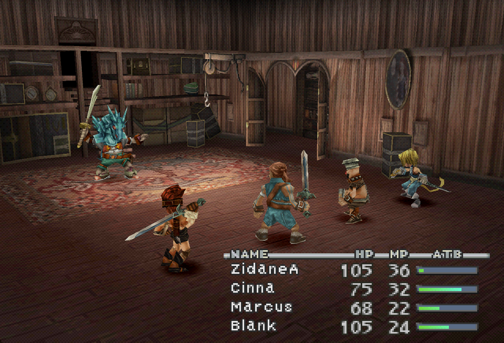
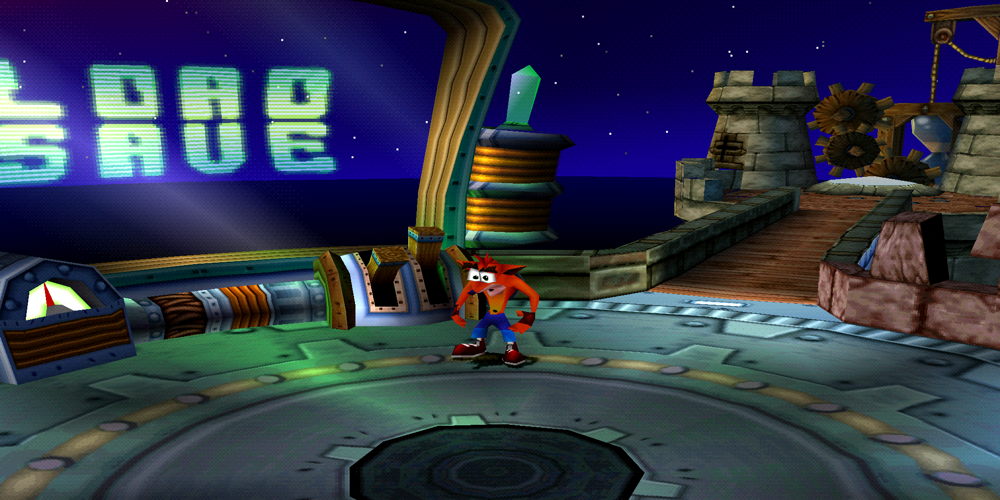
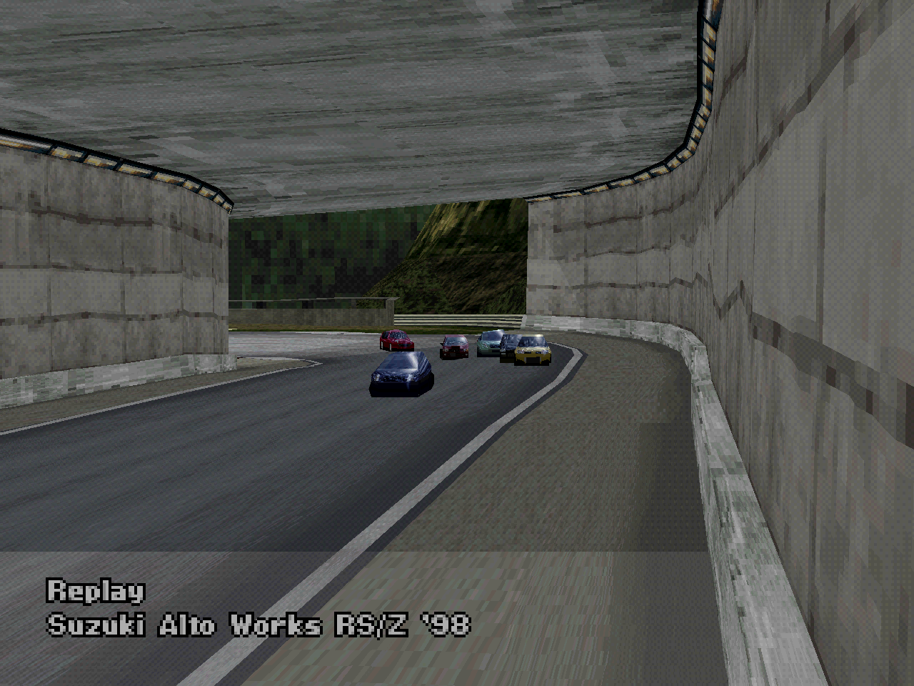
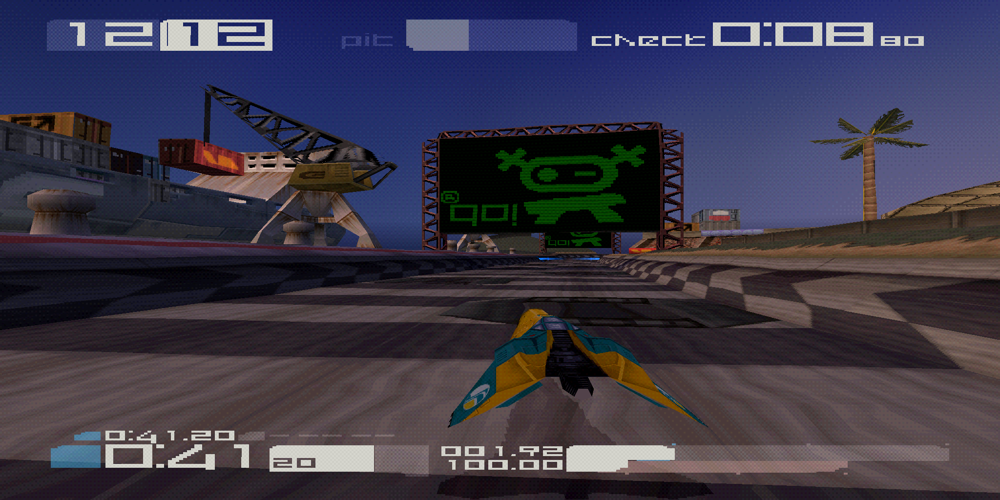
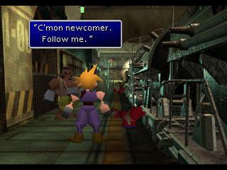

# Compatibility gallery images

The user approved selected screenshots of games running in muyiunative for the compatibility gallery on 2026-11-02, requested FF IX and Crash images on 2026-11-03, GT2/WipEout images on 2026-11-04, and the FF VII image on 2026-11-06. This is the narrow presentation exception in [AGENTS.md](../../AGENTS.md): routine frame-comparison screenshots stay local, and disc images, extracted game code, BIOS dumps, cards and save states remain excluded. Gallery images are never runtime or tool-test inputs and are not included in the launcher's build kit.

The [main gallery](../../README.md#compatibility) links each image to its [game notes](../../profiles/README.md). Images show actual application output, with no generated artwork, retouching or simulated UI. The layout follows [nxnative's gallery](https://github.com/seedds/nxnative#games); add another entry when its verified scope and capture provenance are available.

## Metal Slug X

| Capture field        | Value                                                                 |
| -------------------- | --------------------------------------------------------------------- |
| File                 | `metal-slug-x.png`, 108,991 bytes                                     |
| Captured             | 2026-11-02, Apple M4 Pro, macOS 26.6.2                                |
| App                  | User-built launcher game app, 0.7.0 (build 59), commit `2beb751d663e` |
| Game / region        | Metal Slug X / USA, SLUS-01212                                        |
| Boot executable hash | `0c36eb1775c844e991fe136d6e1a66dad8d79eeda4be1bdd577715fc35af98e0`    |
| Route                | First 7,000 presented frames of the profile's `first_level` route     |
| Renderer / output    | Metal 4×, original unmodified PNG, 1280×960                           |
| Display FNV-1a hash  | `9e695abc708ab89c`                                                    |
| PNG SHA-256          | `0dbc03530cc4f5fe7f5fd1416ea7d03085b1a84be740fa1e38e3ffefb58932c2`    |

The inputs and pulses in [game.toml](../../profiles/SLUS-01212/game.toml) were expanded by [replay.py](../../tools/replay.py), stopping at 7,000 frames. The existing game app then ran headlessly with `--input-file <expanded-route> --frames 7000 --renderer metal --scale 4 --verify-renderer --png <output>`. Native Metal VRAM/cache agreed with software on every frame; all 1,972,644,276 CPU instructions ran natively. This capture check does not extend the game's [verified scope](../../profiles/SLUS-01212/README.md).

The local game app and its bundled disc were read without modifying them; headless capture used no persistent memory cards. Only selected output images belong in this gallery, not discs, generated code or raw run logs. The depicted game's artwork remains its rights holders' work; the project's MIT software license does not license that artwork.

The README thumbnails use the game window's 4:3 display aspect. The original PNG files keep the renderer's internal pixel grid and dimensions, including non-square PS1 display pixels. No PNG was cropped, repainted, enhanced or recompressed.

## Final Fantasy IX

| Capture field | Value |
| --- | --- |
| File | `final-fantasy-ix.png`, 755,966 bytes |
| Captured | 2026-11-03, Apple M4 Pro, macOS 26.6.2 |
| App | Locally rebuilt game app, 0.7.0 (build 68), base commit `810eefa5efbe` with uncommitted integration and quick-state changes |
| Game / region | Final Fantasy IX / USA, Disc 1, SLUS-01251 |
| Boot executable hash | `e30e40745d079aed7071c130785fb42406d8857bdf5484a101ec9baed143ee1c` |
| Route | 24,720 presented frames from reset, profile `validation` route |
| Renderer / output | Metal 4×, original unmodified PNG, 1280×872 |
| Display FNV-1a hash | `e96e2c2a5c0ac791` |
| PNG SHA-256 | `200871006866dda89151ea1362d7e768e64262332d95427b55fb85a35a3b42a0` |

The packaged app replayed the normal inputs in [game.toml](../../profiles/SLUS-01251/game.toml) headlessly with `--input-file <expanded-route> --frames 24720 --renderer metal --scale 4 --verify-renderer --png <output>`. Every frame's native Metal VRAM/cache matched software; all 7,904,116,658 CPU instructions ran natively, with none interpreted. The image shows the [verified scene](../../profiles/SLUS-01251/README.md), not a completed game. This capture uses the local fixes documented in that profile; it does not describe the older public 0.7.0 binary.

The capture began from reset with no persistent memory cards or loaded quick state. The selected PNG was copied byte for byte into the gallery; comparison captures, checkpoints and raw logs remain outside the repository. The app, bundled disc and user saves were not modified.

## Crash Bandicoot 3 - Warped

| Capture field | Value |
| --- | --- |
| File | `crash-bandicoot-3.png`, 1,122,216 bytes |
| Captured | 2026-11-03, Apple M4 Pro, macOS 26.6.2 |
| App | Locally rebuilt game app, 0.7.0 (build 68), base commit `810eefa5efbe` with uncommitted integration and quick-state changes |
| Game / region | Crash Bandicoot 3 - Warped / Europe, Australia, SCES-01420 |
| Boot executable hash | `69d1699f2792867055929bc6ff11ebdfe18a5d09c7974f0bf33f285578c738c3` |
| Route | 14,400 presented frames from reset, profile `validation` route |
| Renderer / output | Metal 4×, original unmodified PNG, 2048×1024 |
| Display FNV-1a hash | `40bcd031370c01b6` |
| PNG SHA-256 | `8f0357241a03a38faff099b75a680c1a38e1e63818a9bd51ed3fa72c3f6cd397` |

The packaged app replayed the normal inputs in [game.toml](../../profiles/SCES-01420/game.toml) headlessly with `--input-file <expanded-route> --frames 14400 --renderer metal --scale 4 --verify-renderer --png <output>`. Every frame's native Metal VRAM/cache matched software; all 5,904,716,904 CPU instructions ran natively, with none interpreted. The image shows the [verified scene](../../profiles/SCES-01420/README.md), not a completed game. This capture uses the local fixes documented in that profile; it does not describe the older public 0.7.0 binary.

The capture began from reset with no persistent memory cards or loaded quick state. The selected PNG was copied byte for byte into the gallery; comparison captures, checkpoints and raw logs remain outside the repository. The app, bundled disc and user saves were not modified.

## Gran Turismo 2 - Simulation Mode

| Capture field | Value |
| --- | --- |
| File | `gran-turismo-2.png`, 650,405 bytes |
| Captured | 2026-11-04, Apple M4 Pro, macOS 26.6.2 |
| App | Locally rebuilt game app, 0.8.0 (build 74), base commit `8baecaf0ba97` with the uncommitted Metal/audio corrections prepared for 0.8.1 |
| Game / region | Gran Turismo 2 - Simulation Mode / USA, v1.2, SCUS-94488 |
| Boot executable hash | `4dd40d01a3e83967e2d4301106890eb314d72027802bee077bbbc246f152e331` |
| Route | 9,000 fields from reset, profile `validation`: Japan Nationals → Midfield Raceway replay |
| Renderer / output | Metal 4×, original unmodified PNG, 1280×960 |
| Display FNV-1a hash | `f2bb9657bbec112f` |
| PNG SHA-256 | `ddb5ccb66a91278ca6b3c8d6805d0b1e3e4cf215a8a3c573cb85dd85185e8203` |

The packaged app replayed the normal inputs in [game.toml](../../profiles/SCUS-94488/game.toml) headlessly with `--input-file <expanded-route> --frames 9000 --renderer metal --scale 4 --verify-renderer --png <output>`. Every frame's native Metal VRAM/cache matched software; all 2,944,191,223 CPU instructions ran natively, with none interpreted. The image shows the [recorded scene](../../profiles/SCUS-94488/README.md), with the user's reported issues confirmed resolved on 2026-11-04. This does not establish completed events or whole-game compatibility.

The capture began from reset with empty memory-card slots and no loaded quick state. The selected PNG was copied byte for byte into the gallery. Only this presentation image is retained; comparison captures, packet traces, checkpoints and raw logs remain outside the repository. No game app, disc or user save was modified by capture.

## WipEout 3 - Special Edition

| Capture field | Value |
| --- | --- |
| File | `wipeout-3-special-edition.png`, 699,690 bytes |
| Captured | 2026-11-04, Apple M4 Pro, macOS 26.6.2 |
| App | Locally rebuilt game app, 0.8.0 (build 74), base commit `8baecaf0ba97` with the uncommitted Metal/audio corrections prepared for 0.8.1 |
| Game / region | WipEout 3 - Special Edition / Europe, multilingual, SCES-02845 |
| Boot executable hash | `0213f5292fa1d995ebe61f42d5dbdb6614e481cb3840ac5f1521c2dfdccc0a4d` |
| Route | 18,000 fields from reset, profile `validation`: Porto Kora single race, Vector class |
| Renderer / output | Metal 4×, original unmodified PNG, 2048×1024 |
| Display FNV-1a hash | `d814bb8fdc1b3cde` |
| PNG SHA-256 | `8f09d992b8f64aba5c5731d0fe6f9eb4c2bebf7f07a021179bdaa396f6c220c1` |

The packaged app replayed the normal inputs in [game.toml](../../profiles/SCES-02845/game.toml) headlessly with `--input-file <expanded-route> --frames 18000 --renderer metal --scale 4 --verify-renderer --png <output>`. Every frame's native Metal VRAM/cache matched software; all 6,704,686,462 CPU instructions ran natively, with none interpreted. The image shows the [recorded scene](../../profiles/SCES-02845/README.md), with the user's reported issues confirmed resolved on 2026-11-04. This does not establish completed events or whole-game compatibility.

The capture began from reset with empty memory-card slots and no loaded quick state. The selected PNG was copied byte for byte into the gallery. Only this presentation image is retained; comparison captures, packet traces, checkpoints and raw logs remain outside the repository. No game app, disc or user save was modified by capture.

## Final Fantasy VII

| Capture field | Value |
| --- | --- |
| File | `final-fantasy-vii.png`, 89,870 bytes |
| Captured | 2026-11-06, Apple M4 Pro, macOS 26.6.2 |
| App | Locally rebuilt game host, 0.9.0 (build 83), base commit `fd41edc43d17` with the uncommitted MDEC corrections prepared for 0.9.1 |
| Game / region | Final Fantasy VII / Europe, Disc 1, SCES-00867 |
| Boot executable hash | `e81ad4795b295c8f3c0af2718d2c09e887dcd142fd8940b9ae16b42c99044bb5` |
| Route | 12,051 frames from reset, New Game → opening movie → first field dialogue |
| Renderer / output | Software, original unmodified PNG, 320×240 |
| Display FNV-1a hash | `d592ed0f68b5b7ea` |
| PNG SHA-256 | `1acb2ec08d5fe226089b793a9813bd69d51da24f88b82bdf3c6ad01186ff8483` |

The game host replayed the normal inputs now recorded in [game.toml](../../profiles/SCES-00867/game.toml), with `--bios <bundled OpenBIOS> --disc <local Disc 1> --headless --lockstep --frames 12051 --input <route events> --png <output>`. Native execution agreed with the interpreter at all 97,145,525 stops; 4,209,310,383 instructions ran natively and 299,921,161 were interpreted. The image shows the [verified scene](../../profiles/SCES-00867/README.md), not a completed game. The user confirmed the corrected game and requested its gallery entry on 2026-11-06.

The capture began from reset with empty memory-card slots and no loaded quick state. The selected PNG was copied byte for byte into the gallery. Only this presentation image is retained; movie comparison captures, traces, checkpoints and generated code remain outside the repository. No disc or user save was modified by capture.
