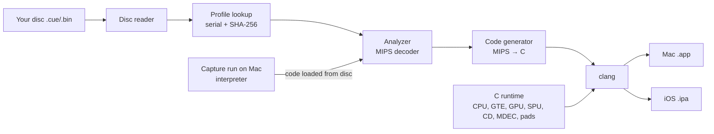

The plan uses only permissively licensed parts in the app and its tools, builds everything on the Mac before the game ever runs, and puts the Mac first with iOS reusing the same runtime.

## 1. Approach

| Approach                                    | Description                                                                                                                                                                                                                                                               | Verdict                                         |
| ------------------------------------------- | ------------------------------------------------------------------------------------------------------------------------------------------------------------------------------------------------------------------------------------------------------------------------- | ----------------------------------------------- |
| **A. Interpreter first, recompiler second** | Build the hardware runtime around a simple MIPS **interpreter** first: code that executes PS1 instructions one by one, like an emulator. Once games run correctly, add the recompiler. The interpreter remains as the safety net and as the reference to compare against. | ✅ **Recommended**                              |
| B. Recompiler first (the N64Recomp style)   | Translate to C immediately and build the runtime alongside it                                                                                                                                                                                                             | Hard to debug with nothing to compare against   |
| C. Replace the BIOS with our own code       | Skip the BIOS and implement its functions directly in C                                                                                                                                                                                                                   | Fragile across games; maybe later as a speed-up |

The end result of A and B is the same. A gets there in a safer order, which matters at a few hours a week.

## 2. Architecture



**Components:**

- **Python tools**:
  - Disc reader: `.cue`/`.bin` and the CD's ISO9660 file system
  - Executable loader for the PS1's PS-X EXE format
  - Profile lookup
  - Analyzer: finds where functions start and end, and handles jump tables
  - Code generator: must handle MIPS **branch delay slots and load delay slots** (the instruction after a branch or load executes before its effect lands)
  - Capture runner and packager
- **C runtime**:
  - Memory map (2 MB RAM, 1 KB scratchpad, 512 KB BIOS)
  - CPU state and interrupt/exception handling (COP0)
  - Timers, DMA, a scheduler that counts CPU cycles
  - GTE (3D math), GPU (1 MB of video memory), SPU (sound)
  - CD-ROM drive (including XA audio and CD music)
  - MDEC (video decoder), controllers and memory cards
- **Lookup table**: maps an address to its native function; if none exists, the **interpreter** runs that code.
- **Graphics**: the software renderer keeps canonical console VRAM. An independent Metal command renderer matches it at native resolution and supplies 2×/4× geometry; the software renderer remains the reference and the default.
- **App shells**: AppKit/SwiftUI on Mac; UIKit with touch controls and Game Controller support on iOS.
- **BIOS**: OpenBIOS (MIT), bundled and itself recompiled.

**Core rule: code is never generated on the device.** Everything is compiled on the Mac at build time. That's what allows iOS at all, and it's compatible with Apple's hardened runtime on Mac.

## 3. Repository layout

```
ps1native/            (working name)
  tools/              Python: disc, exe, mips, analyze, codegen, overlays, replay, mac_build, pack_app; C: capture (what a program runs, at build time)
  scripts/            Run by the user: ps1native (build an app), disc_info (identify a disc), native_game (native code checked in lockstep), survey_game (capture unknown games)
  runtime/            C: cpu, cpu_ops, interp, native, lockstep, capture, mem, gte, gpu_sw, render, spu, cdrom, mdec, sio, sched
  gfx/metal/          Metal command renderer, offline shaders and presentation
  shell/mac/  shell/ios/
  bios/openbios/      MIT, bundled
  profiles/<serial>/  game.toml: hash, overlays, function hints, patches
  tests/              homebrew test programs (no game data); unit tests sit beside their code (runtime/tests, shell/mac/tests, gfx/metal/tests, tools/tests)
  docs/               development: building, tests, CI, house style
```

## 4. Phases and exit criteria

Phases 0–6 have met their exit criteria. Phase 2's homebrew tests are the hardware test programs of [ps1-tests](tests/ps1-tests/README.md), which pass in CI, and its [first game](profiles/SLUS-01212/game.toml) reaches its title menu, checked again on 2026-10-30 with the runtime of commit a0d26af. [Development](docs/development.md#phase-2-hardware-breadth) records the checks and the remaining gaps. Phase 3's main executable, the first game's, runs as native code and agrees with the interpreter in lockstep through the same route, on 2026-10-30 with the runtime of commit 52cedd3 ([Development](docs/development.md#phase-3-the-recompiler)). Its performance profile found the time in a looping GPU DMA list executing without guest time passing. Phase 4 schedules those packets in guest time and preserves overwritten code versions by content hash. On 2026-10-30 the first game clears Mission 1 entirely natively and agrees with the interpreter through the results screen: 22,985 frames and 6,553,245,179 instructions, with normal pad inputs and five continues. [Development](docs/development.md#phase-4-overlays-and-profiles) records the route, the lockstep comparison and the remaining hardware-timing gaps. On 2026-10-31 phase 5 builds its signed, double-clickable Mac app from the disc, rechecking the same route in lockstep, with persistent cards in Application Support, keyboard remapping and a launcher. The tool tests also boot a synthetic app independently of its original input disc ([Development](docs/development.md#phase-5-the-mac-product)).

Phase 6 independently draws PS1 operations in Metal, with native VRAM and persistent texture/CLUT caches matching software throughout the first game's 22,985-frame first-level route. Offline shaders and the Graphics menu provide 1×/2×/4× geometry; software remains the canonical console model and default. The performance follow-up parallelizes independent textured rectangles/triangles and untextured triangles while preserving cache order, and models measured flat-rectangle occupancy so GPU DMA waits for readiness rather than flooding the renderer. On 2026-11-01, the full Metal 4× route on the M4 Pro takes 3.04 ms per frame on average, 5.95 ms at p95 and 11.46 ms at maximum, with zero frames over 16.7 ms versus 616 before. Both final image hashes are unchanged. All 6,553,267,283 CPU instructions run natively and agree with the interpreter at 161,859,326 lockstep stops; 4,083 GPU checks cover the parallel paths ([Development](docs/development.md#phase-6-the-metal-renderer)).

The host publishes produced sound before waiting for rendering and refills returned AudioQueue buffers only when a full block of real samples is ready, using the same three buffers and ring capacity. The exact adapter passes live playback checks in warmed title, transition and results windows: no empty queue, padded/missing samples or source changes, with at least two buffers always queued. The CPU-only buffering tests pass 3,969 checks. This completes the measured first-game performance follow-up; phase 7, iOS, is next. Other GPU drawing costs, FIFO/bus accuracy, whole-route audible accuracy and broader game compatibility remain documented limitations.

| #   | Phase                                                                                                                                                                                                 | Done when                                                                                   |
| --- | ----------------------------------------------------------------------------------------------------------------------------------------------------------------------------------------------------- | ------------------------------------------------------------------------------------------- |
| 0   | **Foundations**: repository, MIT license, CI (macOS GitHub Actions), tool and runtime skeletons                                                                                                       | CI builds an empty `.app`                                                                   |
| 1   | **Interpreter + boot**: R3000A interpreter, memory, COP0, interrupts, timers, DMA, minimal software GPU                                                                                               | **OpenBIOS shell shows in a Mac window**                                                    |
| 2   | **Hardware breadth**: CD-ROM, full software GPU, SPU, GTE, MDEC, pads, memory cards                                                                                                                   | Homebrew CPU/GTE/GPU tests pass; **first game reaches its title screen** on the interpreter |
| 3   | **Recompiler v1**: exe loader, function discovery, MIPS→C, cycle counting, recompiled OpenBIOS                                                                                                        | Main executable runs native and **matches the interpreter** in lockstep comparison          |
| 4   | **Overlays and profiles**: capture runs on Mac, overlay compilation keyed by content hash, a check that the RAM still holds the expected bytes before running native code, a survey for unknown games | First game mostly native and playable through its first level                               |
| 5   | **Mac product**: `ps1native build disc.cue --platform mac-app`, launcher, saves in Application Support, keyboard remapping                                                                            | A double-clickable `.app` built from your disc                                              |
| 6   | **Metal renderer**: hardware rendering and higher resolution                                                                                                                                          | Matches the software renderer frame by frame                                                |
| 7   | **iOS**: same runtime, touch controls, generated Xcode project signed with your developer account                                                                                                     | **First PS1 game running natively on your iPhone**                                          |
| 8   | **More games**: profiles 2 and 3, chosen from different engines                                                                                                                                       | Each new game needs only a profile, no runtime changes                                      |

## 5. Main risks

| Risk                                                                      | Mitigation                                                                                     |
| ------------------------------------------------------------------------- | ---------------------------------------------------------------------------------------------- |
| Code loaded from disc during play, or code that modifies itself           | Capture runs on Mac; native code runs only after a hash check; the interpreter covers the rest |
| Timing (CD-ROM, VSync, sound interrupts)                                  | Count cycles per block of code; compare against the interpreter                                |
| GPU accuracy (semi-transparency, VRAM copies, texture palettes, mask bit) | Software renderer as reference; Metal renderer comes later                                     |
| No symbol names in the game binaries                                      | Analysis heuristics plus calls observed during capture runs; hints in each profile             |
| iOS limits (no runtime code generation, memory limits)                    | Already designed for: everything compiled ahead of time, interpreter fallback                  |
| Legal                                                                     | Clean-room, permissive code only in the app and tools, no disc-derived data in the repo        |

## 6. Testing

- **Instruction tests**: each MIPS instruction checked in recompiled form against the interpreter.
- **Homebrew test programs in CI**: built with homebrew SDKs; check each license.
- **Lockstep comparison**: run recompiled code and the interpreter side by side and compare registers and memory after each call.
- **Frame hashes**: screenshots stay local, only hashes go in the repo. An external emulator can be run separately for comparison (black box, never linked).

## 7. Choosing the first game

- **2D**, with **a single executable** and few disc-loaded code sections
- **No LibCrypt**: an anti-copy protection used on many European (PAL) discs
- Little video playback
- Puzzle games are ideal, e.g. Puzzle Bobble / Bust-a-Move, Tetris variants, Mr. Driller

Dump it with an accurate ripping tool (e.g. redumper) to `.cue`/`.bin`.

## 8. Decision log

| Decision                                                                                    | Alternatives                            | Why                                                                                            |
| ------------------------------------------------------------------------------------------- | --------------------------------------- | ---------------------------------------------------------------------------------------------- |
| MIT license                                                                                 | GPL-3.0                                 | Maximum reuse; independence                                                                    |
| Mac first, then iOS                                                                         | iOS first                               | Mac is the development and debugging machine                                                   |
| Python tools, C runtime, Metal                                                              | Rust, C++                               | Fast iteration; C runs everywhere, including iOS                                               |
| Interpreter first                                                                           | Recompiler first                        | Gives a reference to compare against and a permanent fallback                                  |
| Software GPU first                                                                          | Metal first                             | Correctness before speed                                                                       |
| No code generation on the device                                                            | Compile on the device (as 2Xtreme does) | Required for iOS; works with Apple's hardened runtime                                          |
| OpenBIOS bundled                                                                            | Retail BIOS required                    | Legal, and no BIOS dump needed                                                                 |
| Clean-room, permissive dependencies only                                                    | Fork psxrecomp                          | Independence and license freedom                                                               |
| Conventions from nxnative (MIT): build, front end, tools, rules for contributors and agents | Own conventions                         | A working project of the same shape: native games on Apple platforms                           |
| Plain Makefiles and clang; Python scripts pack the apps                                     | CMake, an Xcode project, SwiftPM        | Nothing to install beyond Xcode and Python; the iOS project is generated (XcodeGen) in phase 7 |
| Objective-C with AppKit for the Mac front end                                               | Swift, SwiftUI                          | Calls the C runtime directly, as nxnative's host does                                          |
| Python tools: standard library, unittest, ruff (bug rules) and pyright; not a package       | pytest, a formatter, a pip package      | They run in place, with no install                                                             |
| Apple silicon, macOS 14 or later                                                            | Intel Macs, universal binaries          | One architecture to build and test, as on GitHub's runners                                     |
| OpenBIOS committed as a binary, built from source (its commit and hash in bios/openbios)    | Build it from a submodule; download it  | Building it needs Docker, beyond Xcode and Python; CI's macOS runners have none                |
| [Metal Slug X (USA), SLUS-01212](profiles/SLUS-01212/game.toml) as the first game           | The puzzle games suggested above        | User's choice; its dump stays outside the repository                                           |
| [ps1-tests](tests/ps1-tests/README.md) (MIT) as the homebrew test programs, as released     | Download or build them; write our own   | The console's logs fit these builds; an exception to permissive-only: PSn00bSDK is MPL-2.0     |
| A disc's licence string (sector 4) stands in for the SCEx string a BIN lacks                | Every disc unlicensed, or all accepted  | Games read their region from GetID; an unlicensed disc is refused, as a console does           |
| Own MIPS decoder in the Python tools, tested against the interpreter                        | rabbitizer (MIT), installed with pip    | Nothing to install beyond Xcode and Python; MIPS I is small, and the interpreter is its check  |
| Cycles per instruction: 1 from the cache, uncached fetches and loads by region, MULT/DIV    | An average per instruction; cache model | Lockstep needs exact counts; ps1-tests measures each cost; a cache costs native code dearly    |
| Interrupts taken at the end of a block of code, in the interpreter and in native code       | Between any two instructions            | Both sides see each interrupt at the same point, so the lockstep comparison is exact           |
| Generated C only in build folders, never in the repository, OpenBIOS's included             | Commit OpenBIOS's generated C           | A game's code is disc data; OpenBIOS's is rebuilt from its committed binary in each build      |
| Keyboard: WASD + IJKL, Q/E, 1/3, Enter and Backspace; remapping in phase 5                  | Arrows + Z/X/A/S; a numeric keypad      | User's choice for a two-hand keyboard layout without a numeric keypad                          |
| Metal comparisons in `gfx/metal/tests`, in CI and locally; skip exit 77 without a device    | CPU-only tests; local-only GPU checks   | Exception to GPU-free tests: synthetic input, real renderer; CI skips absent Metal devices     |
| Offline metallib required by every host build, bundled by `make app`                        | `newLibraryWithSource:` at run time     | No shader source compiled on device; cost: Xcode's Metal Toolchain download, even for software |
| Mac host tests in `shell/mac/tests`, plain and under ASan/UBSan in CI                       | Keep them in `runtime/tests`            | Tests beside their code; keyboard, replay, audio and saves need no GPU or Apple frameworks     |
