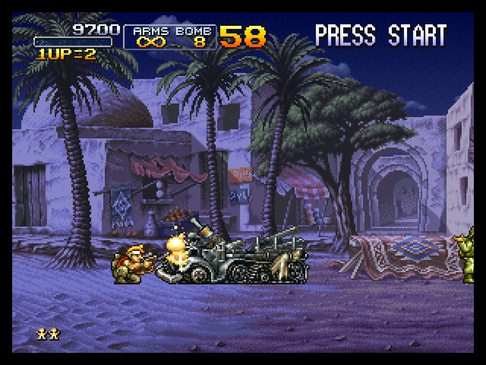

# Metal Slug X

[All games](../README.md) · [Build a game app](../../README.md#build-from-the-launcher) · [Profile and input routes](game.toml)

**Mission 1 verified through its results screen.** The route uses normal pad inputs and five continues. The full game has not been verified. The image shows actual muyiunative output, rendered with Metal at 4×; [capture details](../../docs/images/README.md) identify the build and route.

## Tested revision

| Field           | Value                                                              |
| --------------- | ------------------------------------------------------------------ |
| Platform        | PlayStation; tested on the Mac                                     |
| Region / serial | USA / SLUS-01212                                                   |
| Boot executable | `SLUS_012.12`                                                      |
| Boot SHA-256    | `0c36eb1775c844e991fe136d6e1a66dad8d79eeda4be1bdd577715fc35af98e0` |

The hash identifies the executable, not the whole disc. Other regions or revisions have not been validated by this profile. The Mac host supports Apple silicon and macOS 14 or later; the recorded checks below ran on the M4 Pro with macOS 26.6.2.

## What works in the recorded checks

| Area     | Verified scope                                                                                                                                                                    |
| -------- | --------------------------------------------------------------------------------------------------------------------------------------------------------------------------------- |
| Boot     | OpenBIOS startup, title/main menu and soldier selection.                                                                                                                          |
| Gameplay | Mission 1 through the prisoner-recapture results screen, 22,985 frames. All 6,553,267,283 instructions run natively and agree with the interpreter at 161,859,326 lockstep stops. |
| Graphics | Software and Metal at 1×, 2× and 4×; native Metal VRAM and texture caches match software throughout the route. Switching renderers keeps the game running.                        |
| Input    | Keyboard input; the user confirmed Xbox Wireless Controller input over Bluetooth in the game on 2026-11-02, controller commit fdb7a6e.                                            |
| Audio    | Separate warmed title, transition and results windows have continuous sample delivery; this does not establish whole-route audible accuracy.                                      |

The profile records the first-mission checks on 2026-11-01 and the later boot/menu and 2× checks on 2026-11-02. [Development](../../docs/development.md#phase-6-the-metal-renderer) holds the renderer hashes, timing measurements and audio evidence; [phase 7](../../docs/development.md#phase-7-the-public-preview) records controller and launcher checks. The reproducible inputs and reference image hashes are in [game.toml](game.toml).

## Still open

- The rest of the game, other modes, regions and disc revisions.
- Wired controllers, two physical controllers, and physical hotplug/focus transitions.
- Whole-route live audio accuracy and retail-game save/load checks.
- Broader hardware timing and compatibility gaps documented in [Development](../../docs/development.md#phase-2-hardware-breadth).

The final public-preview acceptance check also remains pending: build from a downloaded launcher without a terminal, then play with a controller. A source-built launcher or one screenshot does not complete that check.

## Report a result

Use [Report a Problem](../../README.md#version-and-problem-reports) for a specific failure, or submit a [compatibility report](https://github.com/lukegskw/muyiunative/issues/new?template=compatibility_report.yml) with the exact app version/commit, boot hash, renderer, controller and progress reached. Keep the disc, game app, generated code and saves on your Mac.
